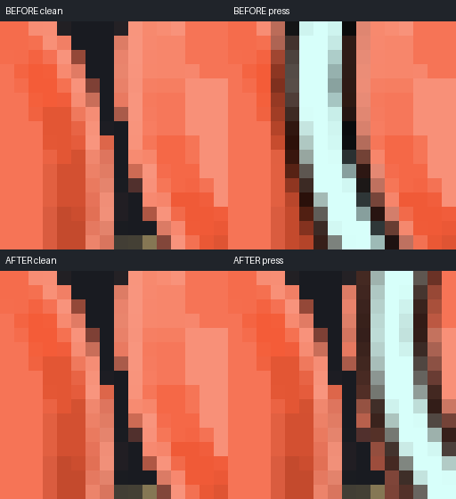
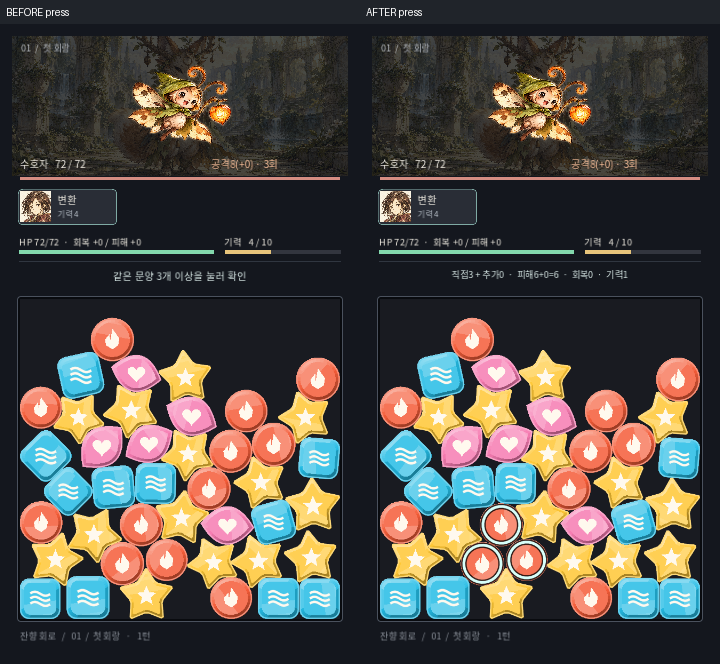

# 접촉 선택 수정 전후 — 2026-10-20

최초 34·35 사례의 강조선 침범과 추가 8·14·9 사례의 연결 누락을 각각 수정했습니다. 독립 검토 결과 **SPEC PASS / QUALITY PASS, 지적 사항 없음**입니다. 검토 대상 소스는 `fbfb5e9478346303e37f850eacead47657dee818`, 비교 기준은 `2f0a4df84c5126c3aa6d3c3f76b6234e82069783`입니다.

## 실제 이미지

원본 크기 비교는 왼쪽이 수정 전, 오른쪽이 수정 후입니다. 각 게임 화면은 배율 변경 없이 붙였으며 제목만 화면 밖에 추가했습니다. 별도 `before/after-clean/pressed.png`는 가공하지 않은 원본입니다.

| 사례 | 원본 크기 전후 | 접점 확대 | 주변 확대 |
|---|---|---|---|
| 최초 34·35, 360×640 | [원본 전후](first34-35-360x640-native-before-after.png) | [16배](first34-35-360x640-edge-before-after-nearest.png) | [4배](first34-35-360x640-context-before-after-nearest.png) |
| 최초 34·35, 720×1280 | [원본 전후](first34-35-720x1280-native-before-after.png) | [8배](first34-35-720x1280-edge-before-after-nearest.png) | [2배](first34-35-720x1280-context-before-after-nearest.png) |
| 추가 8·14·9, 360×640 | [원본 전후](additional8-14-9-360x640-native-before-after.png) | [16배](additional8-14-9-360x640-edge-before-after-nearest.png) | [4배](additional8-14-9-360x640-context-before-after-nearest.png) |
| 추가 8·14·9, 720×1280 | [원본 전후](additional8-14-9-720x1280-native-before-after.png) | [8배](additional8-14-9-720x1280-edge-before-after-nearest.png) | [2배](additional8-14-9-720x1280-context-before-after-nearest.png) |

확대본은 위쪽이 수정 전, 아래쪽이 수정 후이며 각 행은 선택 전/누른 상태 순서입니다. NEAREST 정수 확대를 사용했고 각 패널의 픽셀이 원본 잘라내기의 정확한 반복인지 검사했습니다. GitHub 미리보기 자체가 축소될 수 있으므로 원본 파일을 열어 비교할 수 있습니다.

## 바뀐 동작과 측정

- **최초 34·35:** 몸체 사이 간격은 논리 좌표 2.097805이며 여전히 연결 대상이 아닙니다. 35를 누르면 `[17,18,24,30,35,36]`만 선택합니다. 기존 바깥 강조선이 제외된 34와 배경 틈을 덮었습니다. 실제 회전된 외곽 안쪽으로 강조선을 그리도록 수정해 이 침범을 없앴습니다. 360/720의 34 몸체 마스크 1,500/5,997픽셀에서 새 잉크가 묻은 픽셀은 **0**입니다(채널 차이 >8). 틈의 검사 픽셀도 배경 `[25,27,33]` 그대로입니다.
- **추가 8·14·9:** 자연 리필에서 기록한 14–9 간격 1.383024(다른 동작 기록 1.366276)은 깨끗한 화면에서 접촉해 보이지만 기존 1.0 규칙은 연결을 끊었습니다. 이제 어느 구성원을 눌러도 `[8,9,14]` 전체를 선택합니다. 8–9 직접 간격은 2.83보다 커서 직접 연결하지 않고 14를 통해 연결합니다. 멀리 떨어진 같은 색 19는 제외되며 몸체 마스크 1,459/5,842픽셀에 새 잉크 **0**입니다.
- 매칭 및 두 인접 스킬의 허용치는 **최종 다각형 가장자리 사이 전체 간격 ≤1.75**입니다. 각 기물을 1.75씩 늘리는 뜻이 아닙니다. 물리 접촉/지지 판정은 기존 1.0, 최소 선택 3개, 비용·스킬 상한은 그대로입니다. 선택 강조선의 폭을 접촉 계산에 사용하지 않습니다.

## 검증 범위

격리된 커밋 소스로 접촉 **109/0**, 프레젠테이션 **48/0**, 임포트 종료 0을 확인했습니다. 실제 그래픽 포인터 기록은 두 크기에서 **57/0**입니다. 원본 16장과 비교 패널 12장, 총 28개 PNG를 디코딩하고 크기·SHA-256·패널 픽셀을 검사했습니다. [결과](results.json), [파일·소스 해시 및 확대 좌표](manifest.json).

사진은 기록된 자연 초기/리필 상태를 정확히 재현한 Godot OpenGL 화면 내용과 엔진 주입 포인터 동작입니다. 실제 OS 화면 캡처나 새 완주 기록을 뜻하지 않습니다. 캡처의 접촉 의존 소스 10개는 검토 커밋과 동일합니다. 캡처 Board는 별도 미커밋 리필 후보였지만 고정 상태의 이 비교에서는 리필 진입을 실행하지 않습니다. 기존 Board를 가진 격리 커밋에서도 위 접촉 검사가 통과했습니다. 리필 후보의 승인을 이 이미지로 대신하지 않습니다.

최초 사례의 깨끗한 접점/주변 영역은 두 크기 모두 전후 바이트가 같습니다. 전체 360 보드도 같고, 전체 720 보드는 접점 밖 한 픽셀의 파란 채널만 1 차이 납니다. 추가 사례의 깨끗한 보드는 두 크기 모두 같습니다. 이 결과는 기록된 사례와 검사한 경계의 근거이며 모든 시드·렌더러에 대한 보장은 아닙니다. 전체 Task10 완주·최종 물리/지연 검토는 별도 진행 중입니다.
