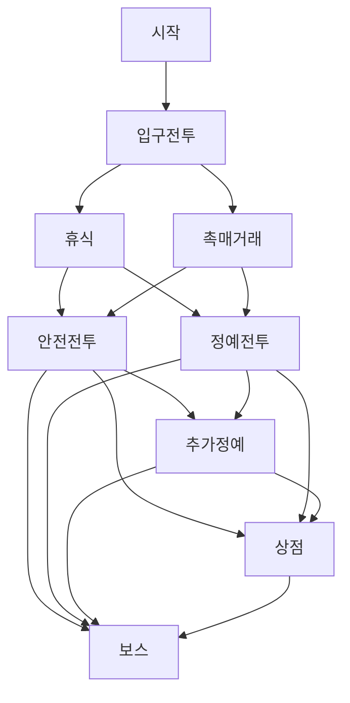

# 자수정 온실: 한 구역의 경로 선택

24f9f19 이후 기존 퍼즐/두 캐릭터/유물/약점/타격/자연 낙하를 유지하며 실제 기본 실행을 한 구역으로 확장했다. 새 일러스트, 새 적 대량 제작, 여러 막, 영구 성장, 파티 모집, 결제는 없다. 수치는 모두 작은 플레이 검증을 위한 **밸런스 가설**이다.

## 실제 경로

8개 지점, 실제 전투3~4회다. 지도에서 현재 연결된 지점만 밝게 고를 수 있고 별도 **입장**으로 확정한다. 앞으로 가능한 길과 이미 지나쳐 닫힌 길을 구분하고 화살표로 방향을 표시한다. 선택 설명에서 적HP·패턴·약점·골드/유물 보상, 휴식/이벤트 비용, 상점 구매 범위를 읽을 수 있다. 보유 HP/G/유물 수/정확한 충전 요구도 표시한다. 방문 즉시 기록하며 역행·재방문·중복 입장은 불가하다.

안전 전투/정예 전투를 고른 후에는 체력과 자금을 보고 바로 보스, 선택 상점, 추가 정예 중 결정한다. 추가 정예는 기존 정예 수호 패턴을 재사용하는 선택 전투다. HP만 늘린 새 적이나 새로운 보스라 주장하지 않는다. 불리하면 건너뛸 수 있고 보상은 더 얻지만 실제 반격과 자원 소모 위험이 있다. 상점 방문/구매는 모두 선택이다.

| 지점 | 공개된 비용·결과 |
|---|---|
| 입구 전투 | 기존24HP/반격4/불꽃 약점. 승리4G+미보유 유물1 |
| 휴식 |3G로 최대8HP 회복(상한30), 또는 무료 통과. 한 번만 선택. FullHP/잔액부족이면 결제 불가 |
| 촉매 거래 |3G로 **화면에 명시된 첫 미보유 유물** 획득, 또는 비용 없이2G. 양쪽 중 한 번만. 유물 소진 시 교환 비활성/무료 재화 선택 가능 |
| 안전 전투 | 기존36HP/경감7→3·일반5/새잎 약점. 승리4G+미보유 유물1 |
| 정예·추가 정예 | 기존44HP/경감8→4·일반6/번개 약점. 각각 승리8G+미보유 유물1 |
| 작은 상점 | 기존4G/최대8HP,8G/남은 유물1, 각1회. 구매하지 않아도 지도로 나갈 수 있음. 없는 네 번째 유물 판매 없음 |
| 마지막 결정룡 | 기존48HP/가능한 강타10→4·일반6/물결 약점. 승패 종료. 이후 재화 지급 없음 |

전투 보상에서 이미 유물3종을 모두 보유했다면 유물 대신 **추가4G를 딱 한 번 지급**하고 확인 화면을 연다. 예를 들어 추가 정예는 기본8G+대체4G=12G다. 확인은 재지급하지 않는다. 보상은 encounter 번호가 아니라 **전투 노드 ID**로 기록하므로 같은 정예 패턴의 추가 전투도 누락되거나 복제되지 않는다.

## 자원과 입력 계약

HP/G/캐릭터/유물/충전 진행/실제2·3 요구량/Ash 예약은 지점·전투 사이에 유지한다. 휴식·이벤트·상점은 턴/충전/스킬 사용을 올리지 않고 현재 보드나 게임 RNG를 바꾸지 않는다. 다음 전투만 정상 initializer의 새 보드를 사용한다. 첫 입구는 출발 시 생성한 정상 보드를 재추첨 없이 사용한다. 이전 보드의 핵과 변환은 새 전투로 이월하지 않는다.

피해·회복·코어·약점·예고 조건은 기존 planner/combat를 그대로 사용한다. 현재 합법 소거 기회로 예고를 확정하고, 스킬로 불가능 조건을 제조하지 않는다. 소거와 보충이 끝난 뒤 사망/보상으로 전환하며, 적 사망이 반격보다 우선이다. 전투가 끝난 뒤 맵에서 오래된 타격/컷인이 새 전투로 남지 않게 시각 상태를 정리한다.

지도 후보/입장, 이벤트, 휴식, 보상은 기존 포인터/화면 serial을 사용한다. 드래그 이탈·포커스 상실·시스템 취소·다른 손가락은 거래/입장/소거를 확정하지 않는다. 지도·휴식·이벤트·상점에서는 보드 입력을 받지 않는다. 결과에는 실제 처치 수, 경유 경로, 캐릭터·유물·잔액을 표시하며 새 출발 선택으로 돌아간다. reset은 방문·지급·재고·선택·런 자원을 모두 새로 초기화한다.

이전3전투는 `-- --short-run` 비교 실행으로 보존했고 sandbox도 유지했다. **기본 앱의 구역 검증과 이전 모드의 회귀를 구분**한다. 보존 모드의41개 회귀를 통과한 것만으로 새 지도까지 검증했다고 계산하지 않는다.

## 검증과 전달

현재 실행 기록과 결과는 [evidence/area](../evidence/area), [최종 회귀](../evidence/area/final-regression/results.json), [독립 검토](../evidence/area/independent-review.md)에 저장한다. 신규 상태/거래/실제 main 입력 검사와 정상 보드 플레이, 실제 OS 작은 창 제스처를 별도로 실행했다. FullHP/부분회복/잔액/정확한 비용, 양 이벤트, 구매/미구매, 유물 소진, 새 전투 상태 유지, 중복·역행, 취소·reset을 포함한다. 정상 플레이의 보드·HP·골드·충전은 주입하지 않는다. 경계 fixture와 정상 획득 과정을 혼동하지 않는다.

실제 기본 main 장면의 자동 정책은 사람이 고른 것처럼 합법 press/release와 자연 process/refill을 사용한다. Attrition은 낮은 즉시 피해와 회복 비선호, 첫 스킬만 사용해 실패 경로를 확인하는 진단 정책이며 사람 실력/밸런스 모델이 아니다. 정상 경로의 완료 수와 실제 자원은 summary.json/trace.json으로 확인한다. 동일 초기 seed라도 의사결정/프레임 경계로 이후 보드는 달라질 수 있다.

정상 진행 영상은 MovieWriter30fps 장면과 실제 소리를 기록한 뒤 읽을 수 있는 지점을 발췌한다. 고정 프레임 녹화와 일반 캡처의 policy/스크린샷/동시 실행 시간을 실시간 성능으로 주장하지 않는다. 이번 구역 패스에서는 별도의 전후 전용 성능 비교를 하지 않았다. 물리/준비 조건/timeout은 변경하지 않았고 기존 중간 경로·반복 보충·정확한 저장 stall 상태 회귀를 유지한다.

진행 중 한 리오 risk 자동 실행은 동시 창/OS 제스처 검사와 겹친 시작 선택 취소로 **전투 진입 전 중단**됐다. 해당 trace와 화면/오류를 보존하고 완료 경로로 세지 않았다. 같은 리오 risk 경로의 단독 재실행은25회 소거·HP24 승리와 선택 복귀로 완료됐다. 초기 취소의 정확한 외부 이벤트는 계측하지 않아 환경 간섭을 확정 원인으로 단정하지 않는다. 이를 전투 패배나 물리 실패라고 바꾸지 않는다.

## 남은 한계

이 자료는 사람의 재미·경로 균형·최종 난이도·상용화 품질 검증이 아니다. 두 캐릭터 초상은 기존 지원 원본을 공유하는 임시 상태다. 실패했던 초상 전송은 재시도하지 않았다. 현재 Windows/Web 실행 패키지는 여전히 오래됐으며 이번에 새 사용자 빌드를 만들지 않았다. 중단 저장/재개, 물리 기기에서의 조작/청취/성능은 남은 항목이다. 앞선 접촉 수정 후 옛 seed23 전체 입력의 ID가 달라지는 한계도 그대로 구분하며, 정확한 저장 상태 회귀만 통과했다고 보고한다. 여러 막·장기 지도·대량 콘텐츠로 범위를 넓히지 않았다.

## 확인된 결과

최종44개 스크립트(이전 보존 모드41개 + 기본 구역 session/input/transaction3개)가 모두 성공했다. 신규 상태33·main입력23·거래20개 세부 검사가 통과했다. 360×640·390×844 실제 OS 입력은 각각24개 통과했고, 마지막 확인은 다른 native 창과 겹치지 않게 순차로 실행했다. 작은 창 거래 장면은 명시적 자원/승리 fixture이며 정상 획득 증거로 세지 않는다.

| 실제 기본 main 정상 자동 경로 | 소거 | 종료HP | 결과 |
|---|---:|---:|---|
| 리오: 휴식→안전→상점 미구매→보스 |13|20|승리·새 선택 복귀|
| 리오: 무료 이벤트→정예→추가정예→상점 회복 구매→보스 |25|24|승리·새 선택 복귀|
| 노아: 유료 휴식→안전→보스 직행 |16|21|승리·새 선택 복귀|
| 노아: 유물 교환→정예→추가정예→상점→보스 |24|30|승리·새 선택 복귀|
| 리오/노아: 별도 attrition 정책 |각20|각0|각 패배·새 선택 복귀|

노아 정상 휴식에서는HP26→30,4G→1G의 상한/비용이 실제 발생했다. 리오 무료 이벤트는4G→6G, 노아 유료 이벤트는4G→1G와 명시 유물 획득이었다. 노아의 추가 정예에서는 이미 유물3개를 보유하여 기본8+대체4G 지급을 확인했다. 모두 기존 initializer·합법 입력·자연 낙하이며 HP/재화/충전/보드 주입은 없다. 사람의 전략 모델이나 동일 보드에서 캐릭터 우열 비교는 아니다.

- [25초 소리 포함 실제 진행 발췌](../evidence/area/area-preview.mp4)
- [약63초 전체 정상 진행](../evidence/area/area-full-run.mp4)
- [최신 실제 위험 경로 선택 화면](../evidence/area/noa-risk-intent-aware-movie/map-extra.png)
- [유물 소진 대체 보상](../evidence/area/noa-risk-intent-aware-movie/relic-exhausted.png)
- [실행별 요약과 한계](../evidence/area/summary.json)

영상은720×1080/30fps H264와48kHz AAC다. 녹음 데이터의 비영점/피크를 확인하며, 실물 청취나 주관적 믹스 평가는 하지 않았다. FFmpeg의 첫 전체/마지막 프레임 변환은0을 생략한 소수 인수가 거부되어 실행되지 않았고, 명시적인0.3/-0.2로 수정해 실행했다. 로그를 보존했다. 원본은 실제 고정 프레임 게임 녹화이며 gray exit 이전에 종료한다. Library 전달은 부모가 담당한다.

과거16행동 성능 replay를 사용할 때에는 `-- --short-run`을 명시한다. 이 기록 입력은 새 분기 구역의 전체 경로 성능 검사가 아니다.

시각적 잔여: 비전투 모달 위의 좁은 띠에 기존 표적 그림의 일부가 보이는 경우가 있다. 조작/숫자를 가리지는 않으며 이번에 추가 시안·외형 정리 루프를 늘리지 않았다. 후속 UI 정리 대상이다.

지도에는 개수뿐 아니라 보유 유물 아이콘·이름도 표시해 현재 빌드를 보고 경로를 고를 수 있게 했다. 마지막 추가는 표시뿐이며 동일 최종 소스로 정상 영상을 다시 기록하고 작은 창24개씩을 순차 재검사했다.
